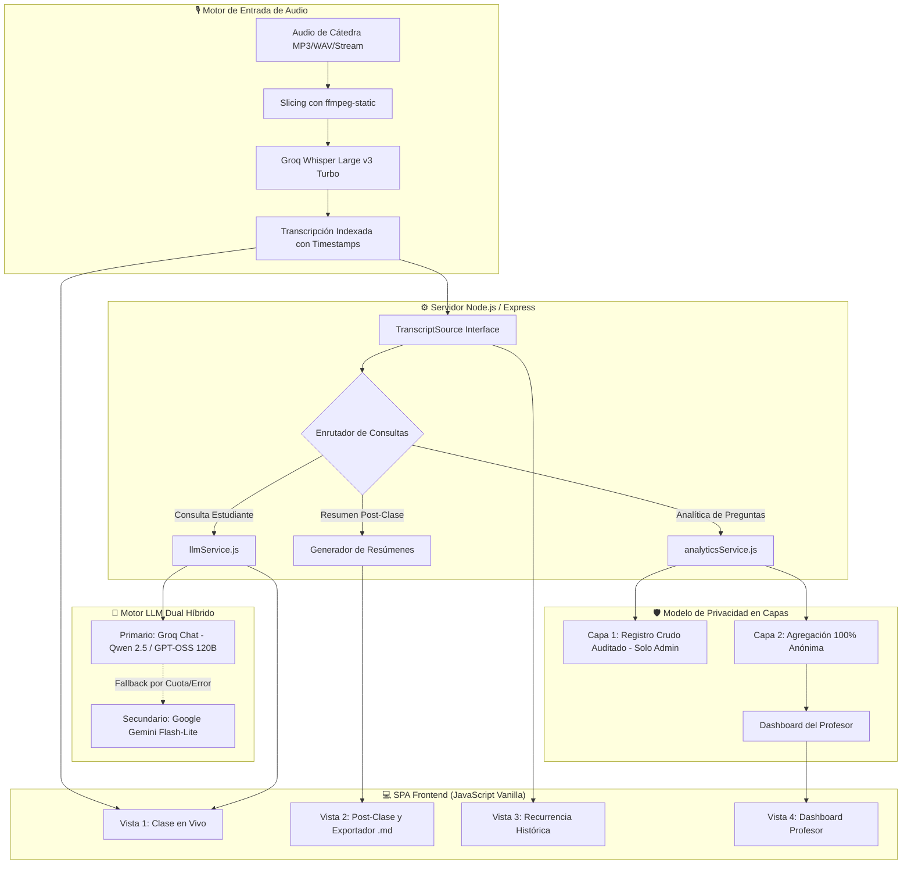
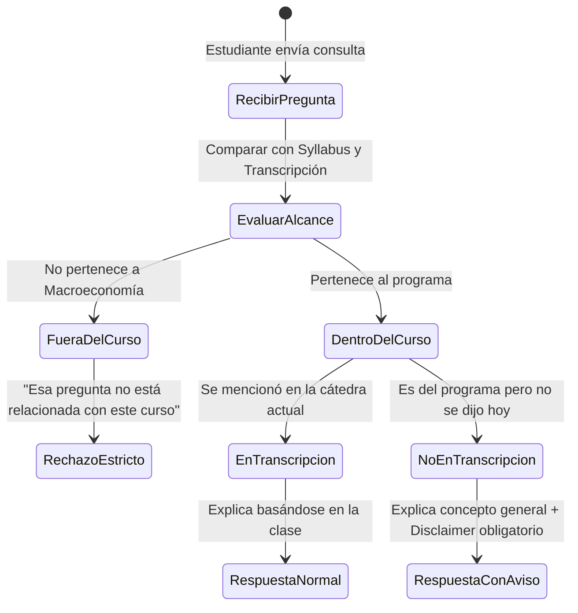

# 🏛️ Cátedra Viva: Aula Aumentada con Inteligencia Artificial

> [!abstract] Resumen Ejecutivo
> **Cátedra Viva** es una plataforma web de asistencia pedagógica en tiempo real diseñada específicamente para **clases expositivas universitarias** (cátedras magistrales). Transforma una clase tradicional en un entorno de aprendizaje aumentado mediante transcripción continua, un tutor conversacional en vivo acotado estrictamente al currículo del curso, memoria acumulativa inter-clases (recurrencia histórica) y un panel analítico docente que alerta sobre lagunas de comprensión en tiempo real bajo un modelo ético de **privacidad en dos capas**.

---

## 1. Contexto, Problema y Justificación

### 1.1 El Problema Central de la Cátedra Expositiva
A pesar de la evolución tecnológica, la cátedra expositiva universitaria sigue siendo un **evento efímero**: el conocimiento se transmite una sola vez, en un espacio-tiempo rígido, y desaparece salvo por los apuntes parciales que cada estudiante logra tomar. Esto genera tres fricciones críticas:

1. **Barrera de Accesibilidad y Ritmo:** Estudiantes con dificultades auditivas, neurodivergencia o ritmos de procesamiento distintos no pueden pausar ni consultar conceptos base sin interrumpir la clase o quedar descolgados.
2. **Pérdida Irrecuperable de Información:** Si un alumno se distrae 3 minutos o no entiende un ejemplo clave (ej. el mecanismo de transmisión de la tasa de interés en el mercado de dinero), no tiene forma de recuperar ese instante sin recurrir a grabaciones completas de 90 minutos sin indexar.
3. **Conocimiento Desconectado y Efímero (Falta de Memoria Histórica):** Cada semestre la misma cátedra se dicta "desde cero". No existe un registro estructurado y comparable de cómo se abordan los conceptos año a año, ni entre distintas secciones del mismo ramo.

### 1.2 Tesis de Valor y Feedback del Profesor Celis
> [!quote] Feedback Docente (Profesor Celis)
> *"Transcribir y resumir ya no es innovador por sí solo. El valor real está en acotar la herramienta al aula física universitaria, controlar estrictamente que la IA no alucine ni enseñe fuera del curso, y construir una base de memoria histórica por ramo."*

En respuesta directa a esta observación, **Cátedra Viva** delimitó su alcance:
- **Enfoque de Scoping Estratégico:** Apuntar exclusivamente a **clases expositivas / magistrales unidireccionales** (ej. cálculo, álgebra, fundamentos de macroeconomía).
- **Fuera de Alcance para el MVP:** Clases de taller, laboratorios o debates grupales abiertos, dado que requieren diarización compleja de múltiples interlocutores y detección de voz en ambientes ruidosos.

---

## 2. Benchmark y Comparativa con Soluciones Existentes

| Dimensión / Herramienta | **Otter.ai / Sonix** | **Verbit (Campus Complete)** | **eeclass (Open Source)** | 🏛️ **Cátedra Viva (Nuestra Solución)** |
| :--- | :--- | :--- | :--- | :--- |
| **Público Objetivo** | Profesional / Reuniones individuales | Institucional (Cumplimiento ADA) | Universitario (China) | **Cátedra Universitaria Local** |
| **Interacción en Vivo** | Solo lectura / Transcripción | Transcripción para accesibilidad | No en vivo (procesamiento post) | **Tutor en vivo acotado con RAG** |
| **Control Curricular** | Nulo (IA genérica) | No aplica | Moderado | **Estricto: Syllabus + Transcripción** |
| **Memoria Inter-Clases** | Carpetas independientes | Archivo institucional plano | Archivo de resúmenes | **Recurrencia histórica comparativa** |
| **Analítica Docente** | No tiene | Reportes de uso | No tiene | **Dashboard en tiempo real (Capa 2 anónima)** |
| **Fricción para el Docente** | Requiere configurar bot | Integración compleja TI | Requiere subir grabaciones | **Cero fricción (plug & play)** |

> [!tip] Diferenciador Clave
> Ninguna solución comercial actual combina un **asistente en vivo restringido curricularmente** con **analítica de aula anonimizada** y **memoria semántica acumulativa entre sesiones**.

---

## 3. Arquitectura del Sistema



### 3.1 Desacoplamiento por Interfaces de Software
1. **`TranscriptSource` (`public/modules/transcriptSource.js`):**
   - Interfaz abstracta que independiza la interfaz de usuario del origen del audio.
   - En el MVP actual funciona con `SimulatedTranscriptSource` (revela texto pregrabado a velocidad 1x, 2x, 5x o revelación instantánea).
   - En producción se conecta directamente a un stream de WebSockets de STT sin tocar una sola línea de código del chat ni de la UI.
2. **`COURSE_CONFIG` (`config/courseConfig.js`):**
   - Configuración desacoplada que almacena los syllabus, glosarios y tópicos del ramo. Permite reutilizar la plataforma en cualquier materia con solo modificar un objeto JSON.

---

## 4. Lógica Pedagógica y Control Curricular del Tutor

Para evitar alucinaciones, respuestas fuera de lugar o que la IA interfiera con el rol del profesor, el chat opera bajo una arquitectura de **RAG Acotado con Sistema de Disclaimers**.



### 4.1 Reglas de las Dos Ramas

> [!example] Caso 1: Pregunta dentro de la clase revelada
> **Pregunta:** *"¿Qué es la curva LM?"*  
> **Comportamiento:** Responde basándose en la explicación de equilibrio en el mercado de dinero ($M/P = L(Y, i)$) dada por el profesor.

> [!warning] Caso 2: Pregunta dentro del curso, pero NO dicha en esta clase
> **Pregunta:** *"¿Qué es el modelo de Solow?"* (Tema de la Unidad 3; la clase es de Unidad 2).  
> **Comportamiento:** Responde conceptualmente, pero antepone obligatoriamente el aviso pedagógico:  
> `> ⚠️ Aviso: Esto no lo dijo el profesor en esta clase, es una explicación general — probablemente lo explique con más detalle más adelante.`

> [!caution] Caso 3: Pregunta ajena al curso
> **Pregunta:** *"¿Cuál es la capital de Francia?"* o dudas de otro ramo.  
> **Comportamiento:** Rechazo estricto inmediato:  
> `⛔ Esa pregunta no está relacionada con este curso.`

> [!tip] Caso 4: Solicitudes de Síntesis
> **Pregunta:** *"Resume los últimos 2 minutos de la clase."*  
> **Comportamiento:** Sintetiza de forma estricta los fragmentos temporales revelados en la ventana de tiempo especificada.

### 4.2 Syllabus Integrado (Macroeconomía IN4123)
- **Unidad 1:** Cuentas nacionales, PIB real/nominal, IPC e inflación, fluctuaciones del ciclo económico.
- **Unidad 2:** Mercados de bienes y dinero, Modelo IS-LM, mercado laboral neoclásico, modelo AS/AD, curva de Phillips, expectativas, modelo Mundell-Fleming.
- **Unidad 3:** Modelo de crecimiento de Solow, convergencia, consumo intertemporal, Q de Tobin.

---

## 5. Analítica de Comprensión y Privacidad en Capas

### 5.1 El Dilema de Privacidad: Trazabilidad vs. Inhibición
Si el estudiante sabe que cada duda básica que escribe queda guardada con su nombre y vista por el profesor, **no preguntará por vergüenza social**. Si no se guarda nada, se pierde el valor pedagógico para la cátedra.

### 5.2 Modelo de Acceso en Dos Capas
- **Capa 1 (Raw / Sistema):**
  - Registro de auditoría con identificador de sesión.
  - Solo accesible por el Administrador de Infraestructura ante situaciones extremas de abuso o vulneración de normas universitarias. Nunca visible para el profesor.
- **Capa 2 (Agregada / Docente):**
  - **100% Anónima:** Métricas globales agrupadas.
  - El profesor ve: *"36% de las dudas se concentraron en la pendiente de la Curva LM entre el minuto 02:00 y 03:00"*.
  - **Principio de Cero Fricción:** El profesor no necesita hacer nada adicional para que funcione. Si revisa el panel, obtiene retroalimentación valiosa; si no lo abre, la clase transcurre con normalidad.

### 5.3 Categorización Semántica en Tiempo Real (`analyticsService.js`)
Cada duda enviada al chat se clasifica de forma inmediata en uno de 5 ejes temáticos:
1. `Curva LM y mercado de dinero` ($M/P = L(Y, i)$)
2. `Curva IS y mercado de bienes` ($Y = C + I + G$)
3. `Políticas Fiscales vs. Monetarias`
4. `Dudas fuera de clase (otra unidad)`
5. `Consultas rechazadas (fuera de curso)`

Calcula alertas dinámicas y emite sugerencias didácticas directas para retomar en la pizarra:
```text
🎯 Sugerencia didáctica para el profesor:
"Conviene dedicar 3 minutos a reforzar por qué un aumento del PIB eleva 
la demanda de dinero y cómo eso presiona al alza la tasa de interés."
```

---

## 6. Funcionalidades de la Aplicación (Módulos Construidos)

```
┌────────────────────────────────────────────────────────────────────────┐
│                        CÁTEDRA VIVA — SPA UI                           │
├─────────────────┬──────────────────┬─────────────────┬─────────────────┤
│ 🔴 Clase en Vivo│ 📋 Post-Clase    │ 🔄 Recurrencia  │ 📊 Dashboard    │
│                 │ (Exportador .md) │    Histórica    │    Profesor     │
└─────────────────┴──────────────────┴─────────────────┴─────────────────┘
```

### 6.1 Pantalla 1: Clase en Curso (En Vivo)
- **Panel Izquierdo:** Transcripción progresiva con insignias del profesor, marcas de tiempo, barra de reproducción y control de velocidad.
- **Panel Derecho:** Chat interactivo con renderizado de fórmulas matemáticas $\KaTeX$, chips con preguntas rápidas y diferenciación visual clara entre citas del docente y explicaciones de la IA.

### 6.2 Pantalla 2: Post-Clase y Exportación de Apuntes
- **Resumen Ejecutivo:** Generado automáticamente por el LLM a partir de toda la cátedra.
- **Conceptos Clave:** Glosario estructurado con marcas de tiempo exactas (`⏱️ [00:02:15]`).
- **Autoevaluación:** Preguntas formativas con pistas analíticas para estudio activo.
- **Buscador Semántico:** Búsqueda libre tipo *"¿Qué dijo el profesor sobre el examen?"*.
- **Archivo Indexado:** Visualización completa de las 38 intervenciones del docente.
- **Botón `📥 Descargar Apuntes (.md)`:** Genera y descarga un archivo Markdown formateado para Notion u Obsidian con toda la sesión organizada.

### 6.3 Pantalla 3: Recurrencia Histórica Inter-Clases
- Permite comparar sesiones consecutivas (ej. Clase 11 de 20 de Septiembre vs Clase 12 de 27 de Septiembre).
- El modelo utiliza el resumen previo como memoria contextual para construir el resumen incremental de la clase actual, mostrando continuidad conceptual.

### 6.4 Pantalla 4: Dashboard del Profesor
- Tarjetas métricas: Alumnos conectados, total de consultas formuladas.
- Alerta didáctica destacada en tiempo real.
- Gráfico de barras temáticas de incomprensión.
- Histograma de densidad de preguntas por minuto a lo largo de la clase.
- Botón **🔄 Actualizar Métricas** para sincronización inmediata.

---

## 7. Especificación de Endpoints (API REST)

| Método | Endpoint | Parámetros Body | Descripción |
| :--- | :--- | :--- | :--- |
| `POST` | `/api/chat` | `{ question, revealedTranscript, currentTimeFormatted }` | Procesa duda de alumno en vivo con Groq/Gemini y registra en analítica Capa 2. |
| `POST` | `/api/summary` | `{ forceRefresh: boolean }` | Genera o devuelve el resumen estructurado, glosario y autoevaluación. |
| `POST` | `/api/post-class-qa` | `{ question }` | Búsqueda y respuesta semántica libre sobre la transcripción total de la clase. |
| `GET` | `/api/transcript` | *Ninguno* | Retorna la lista completa de intervenciones indexadas con timestamp. |
| `GET` | `/api/recurrence` | *Ninguno* | Retorna la comparativa histórica entre sesiones consecutivas. |
| `GET` | `/api/stats` | *Ninguno* | Devuelve estadísticas agregadas y anónimas del aula en tiempo real. |
| `POST` | `/api/stats/reset` | *Ninguno* | Reinicia el acumulador de analítica para una nueva sesión. |
| `POST` | `/api/transcribe-live` | `multipart/form-data (audio)` | Procesa trozo de audio y retorna texto usando Whisper con `ffmpeg-static`. |

---

## 8. Implicancias Éticas y Responsabilidad Social

> [!caution] Consideraciones Éticas Críticas
> 1. **Consentimiento del Docente:** Grabar la voz de un profesor y comparar su desempeño pedagógico año a año requiere autorización explícita y opción de no participación.
> 2. **Asimetría de Datos (Audio vs. Texto):** El audio solo captura al docente; el chat de texto captura las debilidades cognitivas del alumno. Por ello los chats deben estar protegidos por Capa 2 anónima.
> 3. **Riesgo de Sustitución Cognitiva:** Si la IA sintetiza todo automáticamente, existe el riesgo de que el alumno deje de ejercitar su propia capacidad de toma de apuntes y síntesis activa.
> 4. **Gobernanza Institucional del Conocimiento:** Debe definirse si la propiedad de la base histórica de clases pertenece al profesor, al departamento o a la universidad.

---

## 9. Plan de Viabilidad y Validación Empírica

### 9.1 Mapa de Actores
- **Usuarios Finales:** Estudiantes presenciales, remotos y con necesidades de accesibilidad.
- **Beneficiarios Directos:** Equipos docentes (menos consultas repetitivas fuera de aula) y Dirección Académica (retención e inclusión).
- **Decisores:** Dirección del Programa, Finanzas y Dirección de TI.
- **Validadores:** Coordinación Pedagógica, Diseñadores Instruccionales y Seguridad de la Información.

### 9.2 Métricas de Éxito
- **Tasa de Error de Palabra (WER):** Precisión del reconocimiento de voz en términos técnicos económicos.
- **Índice de Relevancia del Chatbot:** Escala Likert aplicada a alumnos piloto (utilidad, precisión y adherencia al tema).
- **Rigor Pedagógico:** Evaluación ciega por pares docentes sobre la fidelidad de las fórmulas y definiciones generadas.

---

## 10. Roadmap Tecnológico

### Fase 1: MVP Funcional (Estado Actual - Completado)
- [x] Transcripción progresiva desacoplada (`TranscriptSource`).
- [x] Motor dual Groq (Qwen/GPT-OSS) + Gemini Fallback.
- [x] Control curricular con disclaimers obligatorios y fórmulas LaTeX.
- [x] Dashboard docente en tiempo real con Capa 2 anónima.
- [x] Generador y exportador de guías de estudio en Markdown (`.md`).
- [x] Despliegue en Render y ejecución multiplataforma.

### Fase 2: Streaming Real y Robusteza (Siguiente Semestre)
- [ ] Transcripción por streaming vía WebSockets en trozos de audio de 5 a 10 segundos.
- [ ] Diarización básica para identificar preguntas de alumnos en voz alta en la sala.
- [ ] Módulo clasificador de intenciones dedicado (guardrail previo de menor costo).

### Fase 3: Integración Institucional
- [ ] Autenticación federada (SSO U-Cursos / EOL).
- [ ] Sincronización automática de syllabus con Canvas / Moodle.
- [ ] Analítica longitudinal histórica para coordinación de docencia.

---

## 11. Puesta en Marcha y Configuración Técnica

### Variables de Entorno Requeridas (`.env`)
```bash
PORT=3000
GROQ_API_KEY=gsk_tu_clave_de_groq_aqui
GEMINI_API_KEY=tu_clave_de_gemini_aqui
```

### Comandos de Ejecución
```bash
# Instalar dependencias (incluye ffmpeg-static para slicing nativo)
npm install

# Iniciar servidor local
npm start

# Verificar sintaxis de scripts
node --check server.js
node --check services/analyticsService.js
node --check services/llmService.js
```

URL de acceso local: `http://localhost:3000`  
Repositorio GitHub: `https://github.com/giftofchalance/catedra-viva-demo`
