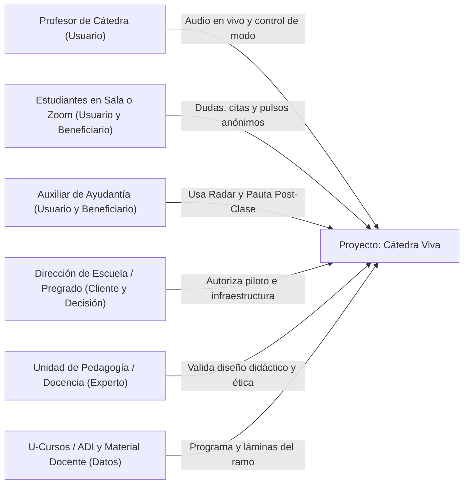
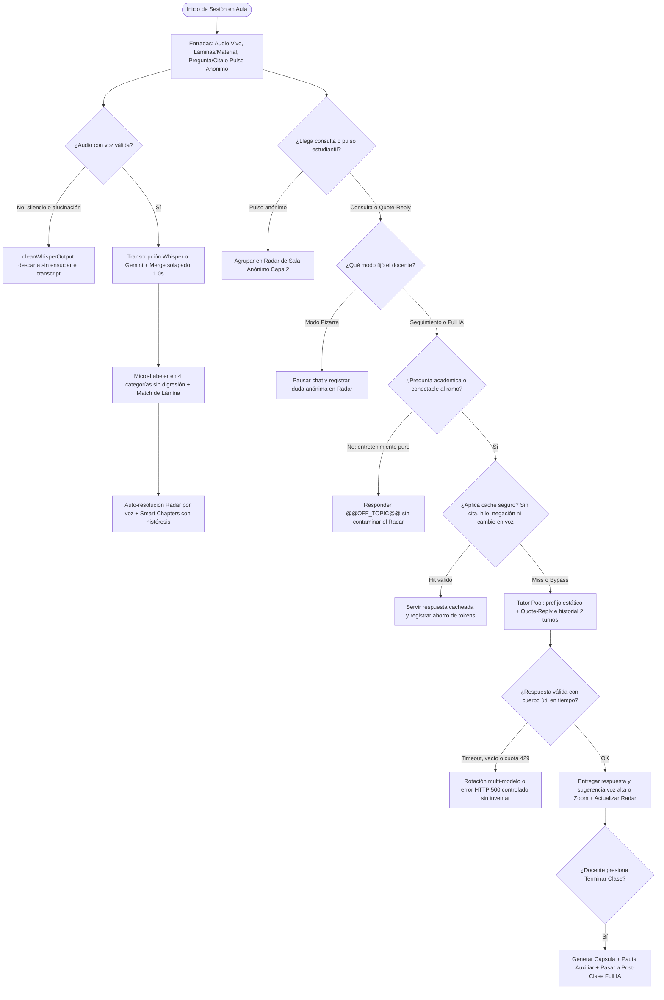

# Cátedra Viva V4 (Clean-Core) — Guía Maestra para la Presentación del Martes

Documento integral de preparación para la presentación del martes. Combina formalmente los **8 entregables del taller (*"Del proyecto a una solución programable"*, 29 diapositivas)** con la arquitectura **V4 Clean-Core**, la defensa pedagógica/ética, los resultados verificados con audio real de aula en pizarra, un diagnóstico transparente de qué falta por hacer y el guión de demostración en vivo.

---

# PARTE I · LOS 8 ENTREGABLES DEL TALLER (PPT SLIDES 1–29)

## Entregable 1 — Definición Formal del Problema (Slides 3–5)

### Fórmula Estructurada (Slide 4)
> **"Queremos ayudar a estudiantes universitarios en clases presenciales o híbridas —y a sus profesores y auxiliares— a resolver la pérdida silenciosa del hilo durante la clase (donde el alumno se traba y no interrumpe, y el docente avanza sin visibilidad de dónde se perdió el curso), mediante una solución que ancla voz en vivo y material del ramo en un co-piloto breve que fomenta levantar la mano y alimenta un radar anónimo en pizarra sin agregar trabajo extra."**

### Las 4 Preguntas Base del Problema (Slide 5)

| Pregunta del Taller | Respuesta Concreta para Cátedra Viva |
|---|---|
| **¿Qué dificultad existe actualmente?** | En clases rápidas o abstractas, basta perder un paso o definición para quedar desconectado el resto de la sesión. Por timidez o ritmo de sala casi nadie levanta la mano, y el profesor tampoco sabe en tiempo real qué punto específico trabó al curso. En clases virtuales (Zoom/Meet) la participación suele caer aún más. |
| **¿Quién la experimenta?** | Principalmente **estudiantes** en cátedras presenciales e híbridas de pregrado (sobre todo ramos cuantitativos o conceptuales densos) y secundariamente **profesores y auxiliares**, que recién descubren las brechas semanas después en un control o ayudantía. |
| **¿Cómo se resuelve hoy sin nosotros?** | 1) Quedarse callado y copiar sin entender; 2) preguntarle a una IA genérica (ChatGPT) que entrega respuestas largas sin contexto de la clase y desconecta aún más al alumno de la pizarra; 3) esperar días por una ayudantía o revisar grabaciones extensas; 4) arrastrar la laguna hasta la evaluación. |
| **¿Qué queremos mejorar exactamente?** | 1) **Reenganche inmediato sin distraer** ni competir con el profesor; 2) **recuperar la oportunidad de preguntar en voz alta** redactando la duda en contexto; 3) dar al docente/auxiliar un **pulso agregado en vivo y post-clase** con fricción cero. |

---

## Entregables 2 y 3 — Usuarios, Beneficiarios, Clientes y Mapa de Actores (Slides 6–8)

*Regla clave del PPT: `Usuario ≠ Beneficiario ≠ Cliente`, y responder con actores específicos aterrizados (nota práctica: para la presentación del martes, conviene nombrar explícitamente el ramo y facultad o escuela piloto concreta donde se evaluaría).*

| Actor Concreto (Contexto Facultad / Piloto) | Rol en el Proyecto | Aporte e Interacción |
|---|---|---|
| **Profesor de Cátedra** *(ej. docente de Economía, Cálculo o Física)* | **Usuario** | Enciende la captura en `/profesor`, elige el modo (`Pizarra`, `Seguimiento` o `Full IA`), ve el Radar si lo desea y presiona `Terminar Clase`. |
| **Estudiantes en Sala o Zoom** | **Usuario y Beneficiario** | Consultan en `/estudiante` (con **Quote-Reply** y citas de clase), envían pulsos anónimos (`Me perdí`, ritmo, ejemplo) y reciben guía breve o estudio post-clase. |
| **Auxiliar / Ayudante de Cátedra** | **Usuario y Beneficiario** | Consulta clusters de dudas y recibe la **Pauta Automática de Ayudantía** generada tras la sesión para enfocar la semana. |
| **Dirección de Escuela / Pregrado / Decanato** | **Cliente y Tomador de Decisión** | Aprueba el piloto en sala, autoriza integración con plataforma docente y sostiene la infraestructura/licencias. |
| **Área de Desarrollo Docente / Pedagogía** | **Experto** | Valida la pertinencia didáctica (ej. que `Seguimiento` fomente participación oral en vez de dependencia del chat) y criterios éticos de uso opcional de datos. |
| **Plataforma Institucional / ADI o U-Cursos** *(+ micrófono docente)* | **Proveedor de Datos** | Entrega programa/diapositivas/láminas del curso en producción; en sala el docente provee el audio en vivo (hoy mediante navegador). |

---

## Entregables 4 y 5 — Inventario de Datos, Fuentes y Gobernanza (Slides 9–14)

*Regla del PPT: **"Dato -> Propósito. No recopilar datos 'por si acaso'"** y **"Acceso técnico ≠ autorización"**.*

### Qué datos NO recopilamos deliberadamente (Privacidad por Diseño)
Para cumplir con ética de aula, EU AI Act y Ley 21.719 de Protección de Datos (Chile), el sistema **excluye desde el diseño**: RUT, nombre, correo o cuenta de estudiante, biometría/huella vocal, grabaciones permanentes de audio, asistencia individual y notas.

### Inventario de Datos (Slide 14 + Disponibilidad Slide 12)

| Dato | Para qué lo necesito (Propósito único) | Quién lo tiene | ¿Existe? / Disponibilidad (Slide 12) | Acceso y Autorización |
|---|---|---|---|---|
| **Audio del profesor en vivo** | Transcribir en tiempo real la explicación y auto-resolver dudas del Radar | Profesor en sala (vía navegador / Zoom) | **Disponible** en aula; se procesa en memoria y se elimina inmediatamente tras transcribir (`ephemeralChunksDeleted`) | Requiere consentimiento explícito del profesor (botón `Iniciar Clase`) y aviso transparente en sala |
| **Láminas / material y glosario del ramo** | Anclar respuestas y citas `[SLIDE-X]` / `[MAT-X]` y reducir errores fonéticos | Profesor / Plataforma docente (U-Cursos) | **Disponible hoy** subiendo `.pdf`, `.pptx`, `.txt`, `.md` o texto (`POST /api/courses/upload`, `/api/materials/upload`); **Potencialmente accesible** automáticamente vía API/LTI institucional | Hoy lo sube el docente directo en sesión; en piloto institucional requiere permiso de Dirección / U-Cursos y derechos de uso en aula |
| **Consultas del estudiante y citas (`quotedContext`)** | Responder en contexto según modo activo y medir temas trabados por fase (`in_class` vs `post_class`) | Estudiante (generado dentro de la app) | **Inexistente** fuera del sistema — lo genera nuestra aplicación de forma anónima | Voluntario y anónimo (sin login ni ID personal); solo se muestra agregado en Radar/cápsula |
| **Pulsos anónimos (`Me perdí`, ritmo, ejemplo)** | Alertar al profesor/auxiliar en segundos si un bloque generó bloqueo colectivo | Estudiantes en `/estudiante` | **Inexistente** fuera del sistema — lo genera nuestra aplicación | Anónimo en Capa 1; profesor solo ve conteo agrupado por tópico en Capa 2 |
| **Resúmenes históricos `[HIST-X]` y métricas agregadas `qaLog`** | Conectar clases previas del mismo ramo y ofrecer comparativa opcional entre clases/semestres | Cátedra Viva tras cierre de sesión | **Inexistente** fuera del sistema — hoy vive en memoria volátil del prototipo | Acceso solo al docente responsable del ramo, uso estrictamente **opcional** (jamás vigilancia ni evaluación punitiva) |

### Los 8 Criterios de Utilización de Datos (Slide 13)
1. **Acceso:** El prototipo opera con captura directa de audio en navegador + carga manual de texto; la sincronización automática con U-Cursos requiere API/LTI institucional.
2. **Calidad:** En audio presencial ruidoso con pizarra, Whisper alcanzó **88% de cobertura** respecto a subtítulos humanos gracias al solapamiento de `1.0s` (`mergeOverlappingTranscript`) y filtros anti-silencio (`cleanWhisperOutput`).
3. **Cantidad:** Con `3` a `5` alumnos mandando señal/duda ya emerge un cluster claro en el Radar; no exige adopción del 100% de la sala.
4. **Formato:** Audio comprimido temporal (`ffmpeg-static` MP3 mono 16kHz), ingesta directa en memoria de **`.pdf` (`unpdf`), `.pptx` (`jszip`), `.txt` y `.md`**, JSON interno estructurado y exportación post-clase en Markdown (`.md`). *(Para PDFs escaneados como imagen sin texto seleccionable se devuelve aviso controlado HTTP `422`)*.
5. **Actualización:** Sincronización en tiempo real en vivo mediante **SSE** (`/api/live/stream` con `stateVersion`) cada segmento de voz o consulta.
6. **Privacidad:** Ningún dato emitido en `/api/live/state` contiene identidad estudiantil ni archivos de audio.
7. **Datos personales:** Cero datos personales de alumnos recolectados; al profesor solo se muestra nombre/ramo si él los ingresa.
8. **Autorizaciones:** Antes de piloto real en aula se requiere autorización formal del docente de cátedra + aviso a estudiantes + visto bueno de Dirección de Escuela / ADI para entorno institucional.

---

## Entregable 6 — Matriz de Validación y Supuestos Críticos (Slides 15–19)

*Regla del PPT: **"Creer no es validar"** y **"Una buena validación puede demostrar que estamos equivocados"**.*

Es clave separar explícitamente el **estado real hoy**:
- **Validación técnica y de ingeniería:** **Completada** (audio real de pizarra, casos borde, precisión académica, Quote-Reply, navegador escritorio + móvil).
- **Validación humana en aula real con usuarios externos:** **Pendiente** (es el principal foco no técnico por ejecutar con profesores, estudiantes, auxiliares y tomadores de decisión).

### Buscar Evidencia que Nos Contradiga (Slide 18)

| Pregunta Crítica | Análisis Honesto |
|---|---|
| **¿Qué podría hacer fracasar nuestro proyecto?** | 1) Que los estudiantes usen `Full IA` o ChatGPT igual por su cuenta y sigan sin preguntar ni usar `Seguimiento`; 2) que el profesor perciba cualquier fricción técnica al partir la clase (micrófono, permisos Zoom, copiar material) y deje de abrir la app en la semana 2; 3) ruido acústico severo en auditorios sin micrófono de solapa. |
| **¿Qué supuesto puede ser incorrecto?** | Que una respuesta breve con pregunta sugerida basta para vencer el miedo social a levantar la mano, o que los alumnos preferirán una herramienta de curso en vez de su chat de IA habitual cuando el modo en vivo está restringido. |
| **¿Quién podría cuestionarlo con fundamento?** | Profesores exigentes de cálculo/ciencias (por posible error fino en respuestas IA o distracción con el celular en sala), especialistas en docencia universitaria (si la herramienta fomenta pasividad en vez de escucha activa), o áreas TI/privacidad (al preguntar dónde viaja el audio y el contenido docente). |
| **¿Qué resultado nos haría cambiar la solución?** | Si en un piloto real >70% de los alumnos prefiere esperar o abrir otra app porque `Seguimiento` se siente insuficiente, o si >50% de los profesores apaga la herramienta por carga operativa/acústica -> habría que pivotar hacia un **asistente puramente post-clase + Radar anónimo sin chat en vivo**, o hacia integración directa en hardware de sala. |

### Matriz de Validación de Supuestos Más Riesgosos (Slide 19 — Cubriendo los 6 Frentes de Slide 16)

| Frente (Slide 16) | Qué necesito validar (Supuesto) | Con quién | Cómo obtener evidencia | Evidencia esperada (y criterio de cambio) |
|---|---|---|---|---|
| **Adopción y Usabilidad Docente** | Un profesor logra iniciar clase y olvidar la pantalla en menos de 60 segundos sin romper su flujo ni su PPT | 2–3 profesores reales de cátedra | Prueba guiada breve en su computador + simulación de 10 min de su propia clase | Completa inicio/cierre sin ayuda; si tarda >2 min o requiere intervención nuestra, simplificar aún más o automatizar con calendario de sala |
| **Problema y Valor Estudiantil** | Estudiantes en vivo valoran el anclaje a la voz de clase + **Quote-Reply** lo suficiente como para usar Cátedra Viva en vez de ChatGPT | 5–8 estudiantes de pregrado | Prueba comparativa (ver 10 min de video de clase compleja usando ChatGPT vs. `/estudiante` móvil) + entrevista corta | Prefieren el anclaje temporal y logran formular al menos 1 pregunta clara; si abren ChatGPT por defecto, reforzar valor en vivo o concentrarse en Radar + Post-Clase |
| **Pedagogía** | `Modo Seguimiento` realmente reengancha sin distraer ni reemplazar el razonamiento propio o la pregunta al docente | 1–2 expertos de docencia / pedagogía + profesor | Revisión experta de transcripciones reales y respuestas generadas en `Seguimiento` vs `Full IA` | Confirman alineamiento didáctico y calibran longitud/tono de sugerencias para levantar la mano |
| **Implementación Institucional y Datos** | Es viable usar audio efímero en sala e integrar material de curso (`.pdf`/U-Cursos) respetando normativa interna | Jefe TI / encargado de datos / Dirección de Escuela | Reunión técnica de factibilidad + revisión de políticas de datos y piloto acotado de 1 sesión | Aprueban piloto en 1 sección con consentimiento; si prohíben APIs cloud externas, activar hoja de ruta `vLLM` local de facultad |
| **Impacto Auxiliar** | La pauta generada y los clusters anónimos ahorran tiempo real al preparar ayudantía | 1–2 auxiliares de ramo | Entregar cápsula/pauta generada tras clase real y pedir feedback de utilidad vs. preparación normal | Identifican al menos 2 dudas que no habrían detectado de otro modo |

---

## Entregable 7 — Flujograma Lógico Completo, Excepciones y Salidas (Slides 20–26)

### Entradas y Procesos Atómicos (Slides 21–22)
- **Entradas concretas (Slide 21):** Audio continuo solapado desde micrófono/Zoom (`POST /api/live/audio-chunk`), subida directa de archivos `.pdf`/`.pptx`/`.txt`/`.md` o texto (`POST /api/courses/upload`, `/api/materials/upload`, `/api/courses/custom`, `/api/materials/add`), consulta estudiantil con `quotedContext` y últimos 2 turnos (`POST /api/chat`), pulsos anónimos (`POST /api/live/lost`, `/api/live/pulse`) y controles docentes (`POST /api/teacher/settings`, `/api/teacher/close-class`).
- **Procesos atómicos (Slide 22):** Extraer láminas/texto desde `.pdf`/`.pptx` (`parseUploadedDocument`) -> Normalizar audio (`ffmpeg-static` 16kHz mono) -> Transcribir y borrar temporal -> Fusionar solapamiento (`mergeOverlappingTranscript`) -> Etiquetar en 4 categorías sin exclusión (`labelAndCleanSegment`) -> Emparejar lámina (`matchSlideForSegment`) -> Auto-resolver Radar y actualizar capítulos (`autoResolveClustersFromVoice`, `maybeUpdateSmartChapters`) -> Evaluar alcance y caché seguro -> Generar respuesta IA -> Compilar cápsula y pauta post-clase.

### Flujograma del Sistema con Decisiones y Excepciones (Slides 23 y 26)

### Manejo de Errores y Excepciones Reales (Slide 24)

| Escenario de Falla (Slide 24) | Cómo lo Maneja Realmente Cátedra Viva V4 en Código |
|---|---|
| **¿Qué ocurre si faltan datos?** | Si el curso no tiene PPT (pizarra libre o curso nuevo sin láminas), `matchSlideForSegment()` retorna `null` y todo degrada a *Pizarra Libre* sin inventar láminas. Si aún no hay voz transcrita, el tutor usa `"(La clase recién comienza)"` apoyado en láminas/glosario; si se sube un PDF escaneado sin texto seleccionable responde HTTP `422` explicando cómo exportarlo, y formatos/inputs inválidos responden HTTP `400`. |
| **¿Qué pasa si el usuario ingresa algo incorrecto?** | Entradas de entretenimiento puro activan `@@OFF_TOPIC@@` sin entrar al Radar. Premisas falsas se corrigen explícitamente según el prompt pedagógico, y consultas coloquiales o prerequisitos quedan protegidas por la guardia determinista `isLikelyAcademicQuestion()` para no bloquear por error. |
| **¿Qué pasa si no podemos calcular el resultado?** | Todas las llamadas a Groq y Gemini aplican `AbortSignal.timeout(15000)`. Si en `Seguimiento` el modelo devuelve solo `@@VOZ_ALTA@@` sin cuerpo explicativo (`<15` caracteres), una guardia reintenta automáticamente con `gemini-3.5-flash-lite`. Si todos los motores fallan, responde HTTP `500` controlado en vez de inventar datos. |
| **¿Qué pasa si una fuente de datos no está disponible?** | **Cascada multi-modelo verificada:** STT rota `whisper-large-v3` -> `whisper-large-v3-turbo` -> `gemini-3.5-flash-lite`; Tutor rota `openai/gpt-oss-120b` -> `qwen/qwen3.8-27b` -> `gemini-3.5-flash-lite` (+ retry); si el micro-labeler sufre `429`, cae a `detectHeuristicCategory()` sin perder ni excluir el texto hablado. |

### Salidas con Valor Concreto (Slide 25)
*"Una salida que nadie usa es código que no era necesario escribir."* — En V4 se aplicó exactamente este criterio al retirar la telemetría de costos USD y tabla CapEx/GPU del panel docente (dejando únicamente el modal humano de **Privacidad** de 3 puntos tanto en `/profesor` como en `/estudiante`) porque no gatillaba decisiones pedagógicas durante la clase.

| Salida del Sistema | Quién la Recibe | Cuándo la Recibe | Acción Concreta que Habilita |
|---|---|---|---|
| **Guía breve + pregunta sugerida / Zoom** | Estudiante | En 1–2 segundos tras preguntar (`Seguimiento`) | Reengancha con lo que explica el docente y le da confianza para levantar la mano o escribir en Zoom |
| **Respuesta profunda con Quote-Reply** | Estudiante | En vivo si el docente abre `Full IA`, o al cierre (`Post-Clase`) | Resuelve el paso exacto que citó, con LaTeX e intuición causal |
| **Banner / Radar de Comprensión** | Profesor y Auxiliar | En tiempo real durante la clase (`!classClosed`) | Decide si detenerse a dar un ejemplo o explicar un término clave; si lo aclara oralmente, se auto-resuelve |
| **Bandeja de Dudas en Standby (`Dudas anotadas`)** | Estudiante | En `Modo Pizarra` (`Anotar`) o con el botón reloj en vivo | Permite anotar dudas al vuelo con su minuto `[MM:SS]` para volver a mirar la pizarra y elegir después `Resolver ahora` o `Ya entendí` |
| **Apunte Vivo + Pauta Auxiliar (`.md`)** | Profesor, Auxiliar y Estudiantes | Inmediatamente al pulsar `Terminar Clase` | Descarga de apunte unificado (incluye dudas anotadas del alumno) para llevarlo a cualquier herramienta externa y preparación de ayudantía sin coordinación extra |

---

## Entregable 8 — Backlog Técnico: Del Flujograma al Código (Slides 27–28)

### A. Mapeo 1-a-1 de Bloques Implementados Hoy en V4 (Ya Programado)

| Bloque Lógico del Flujograma | Implementación Real Verificada en Cátedra Viva V4 / V4.1 |
|---|---|
| `parsear_archivo_clase()` | `parseUploadedDocument()` (`services/documentParser.js` vía `jszip` / `unpdf`) -> `POST /api/courses/upload` y `POST /api/materials/upload` (`routes/courseRoutes.js`) + `attachCourseSlides()` (`data/coursesDb.js`) |
| `obtener_y_limpiar_audio()` | `routes/liveRoutes.js` (`ffmpeg-static` 16kHz mono + eliminación inmediata en disco) -> `transcribeLiveAudio()` + `cleanWhisperOutput()` (`services/stt.js`) |
| `deduplicar_y_etiquetar()` | `mergeOverlappingTranscript()` (`services/stt.js`) -> `labelAndCleanSegment()` con 4 categorías sin `digresion` (`services/labeler.js`) |
| `mapear_lamina_y_capitulos()` | `matchSlideForSegment()` (`data/coursesDb.js`) + `maybeUpdateSmartChapters()` con histéresis (`services/radar.js`) |
| `agrupar_y_autoresolver_radar()` | `detectTopicCluster()` + `autoResolveClustersFromVoice()` (`services/radar.js`) + `upsertTopicCluster()` (`state/sessionStore.js`) |
| `validar_cache_y_responder()` | `checkSafeSemanticCache()` + `isFollowUpQuestion()` (`services/semanticCache.js`) -> `isLikelyAcademicQuestion()` + `answerStudentQuestion()` (`services/tutor.js`) |
| `bandeja_dudas_standby()` | `addStandbyDoubt()`, `resolveStandbyDoubt()` y `#standbyDrawer` (`public/js/student.js`), persistida en `sessionStorage`, con anclaje al `[MM:SS]`, `Resolver ahora` / `Ya entendí` y exportación `.md` |
| `sincronizar_en_vivo()` | Hub SSE `/api/live/stream` con `stateVersion` (`state/sessionStore.js`, `public/js/icons.js`) |
| `generar_capsula_y_postclase()` | `generateFusedPostClassCapsule()` + `generateClassSummary()` (`services/capsule.js`) + `/api/teacher/close-class` |

### B. Backlog Técnico Pendiente (De Prototipo V4.2 a Piloto Real en Aula)
1. **Persistencia en base de datos y multi-sala por código:** Hoy `liveSession` vive en RAM como sesión única por servidor; para uso paralelo en varios cursos reales se requiere SQLite/Postgres + salas aisladas (`/:roomCode`).
2. **Autenticación / PIN docente:** Proteger `/profesor` y las rutas `/api/teacher/*` (hoy abiertas para agilizar demo) antes de abrir pilotos en aula.
3. **Integración institucional (LTI / API U-Cursos y GPU facultad):** Conector oficial de programa/láminas y despliegue `vLLM` intra-campus para soberanía total de datos.
4. **OCR automático para PDFs escaneados como imagen:** Hoy se extrae texto seleccionable (`.pdf`/`.pptx`/`.txt`/`.md`) y se devuelve aviso claro `422` si un PDF viene rasterizado como imagen.
5. **Deduplicación y síntesis semántica batch post-clase:** Mantener en vivo las preguntas *raw* (`$0` y `0 ms` extra en el Radar) y al cierre fusionar únicamente dudas equivalentes reales (misma duda formulada distinto → `×2`) sin mezclar preguntas distintas de un mismo capítulo.
6. **Transcripción viva con *context clues* colapsables:** Detectar conceptos clave mencionados en vivo (ej. `IS-LM`, `Ley de Faraday`) para mostrar chips desplegables colapsados por defecto (`+ Ver fórmula rápida`) y un marcador silencioso de 1 toque sin distraer ni exigir tipear en el chat.

---

# PARTE II · ARQUITECTURA V4 CLEAN-CORE, DECISIONES DE DISEÑO Y DEFENSA TÉCNICA

## 1. Propuesta de Valor Central: "¿Por qué Cátedra Viva y no ChatGPT?"

1. **No mata la oportunidad de levantar la mano — la fomenta:** En `Modo Seguimiento`, entrega 2–3 líneas de reenganche + citas exactas (`[VIVO-X]`, `[SLIDE-X]`, `[HIST-X]`, `[MAT-X]`) + pregunta en primera persona lista para hablar o pegar en Zoom (`@@VOZ_ALTA@@`).
2. **Anclaje vivo + Quote-Reply:** El estudiante cita cualquier bloque hablado o respuesta previa del tutor (`quotedContext`) y conserva memoria acotada de los últimos 2 turnos (`chatHistory`), sin perder el hilo de la pizarra.
3. **Principio "Prender y Olvidarse" para 3 Arquetipos Docentes:** Sirve tanto al profesor que solo inicia/cierra la clase como al estricto (`Pizarra` / `Seguimiento`) o al integrador activo (`Full IA` en vivo + Radar).

---

## 2. Arquitectura y Funcionalidades V4 Clean-Core

- **Separación Real de Modos:**
  - `Modo Pizarra`: pausa respuestas de chat manteniendo captura anónima en Radar.
  - `Modo Seguimiento` *(default)*: respuestas concisas + sugerencia en voz alta.
  - **`En Vivo · Full IA` (`classClosed === false`)**: habilitable durante la clase sin cerrarla ni apagar el Radar.
  - **`Post-Clase · Full IA` (`classClosed === true`)**: activado automáticamente por **Terminar Clase**; desbloquea estudio completo y separa métricas `in_class` vs `post_class` en `qaLog`.
- **Dudas en Standby (Descarga Cognitiva sin Gastar Tokens):** En `Modo Pizarra`, el botón pasa a `Anotar` y guarda cada duda por separado anclada al minuto `[MM:SS]` (mientras igual suma al Radar). En `Seguimiento` / `Full IA`, un botón de reloj permite estacionar dudas sin consultar ahora. Al reactivarse el chat o cerrarse la clase, la bandeja cambia vía SSE a `Listas para resolver` con `Resolver ahora` (responde anclado a lo que decía el profesor en ese minuto) y `Ya entendí` (descarta sin gastar tokens). Sobrevive recargas vía `sessionStorage` y se exporta en el `.md` del Apunte Vivo.
- **Bucle In-Clase ↔ Post-Clase y Portabilidad de la Transcripción:** El activo irrepetible ocurre en vivo (voz + láminas + dudas *raw*), pero su valor se multiplica en el estudio Post-Clase y al poder exportar el apunte `.md` hacia herramientas externas (NotebookLM, Anki, Obsidian o cualquier IA). Como evolución natural hacia cero distracción en sala, el agrupamiento *raw* se sintetiza por equivalencia en batch post-clase y la transcripción puede incorporar *context clues* colapsables (desplegables opcionales de fórmulas sin abrir el chat).
- **Agnosticismo Curricular:** `detectTopicCluster()`, `matchSlideForSegment()` y `maybeUpdateSmartChapters()` (histéresis `>= 50s`, `>= 8` palabras) operan sin reglas fijas por ramo, soportando cursos creados en sesión (`+ Nueva clase` -> `FI2002 Electromagnetismo`).
- **UI/UX Simplificada:** Consola `/profesor` reducida a 2 zonas con **3 tarjetas principales**, iconos SVG estilo Lucide uniformes (`public/js/icons.js`, sin emojis de sistema), vista `/estudiante` móvil con `.topbar` de `48px`, barra inferior de 1 pulgar (`En Vivo | Tutor | Me perdí`), persistencia en `sessionStorage` y citas clicables.
- **Soporte Nativo Zoom / Meet:** Captura directa de audio de pestaña/ventana + QR local (`/api/qr`) sin registro previo.

---

## 3. Decisión Crítica del Micro-Labeler: De *Soft-Tagging* a Cero Exclusión

Al evaluar audio real de pizarra presencial (Prof. María Inés Baragatti), comentarios aparentemente personales o geográficos (*"todos los de La Plata están cerca porque vivo en Bernal... él vive a 10 cuadras"*) resultaron ser **la base intuitiva del concepto de $\epsilon$-vecindad**.

- **Solución definitiva V4:** Se eliminó por completo la categoría `digresion`. `services/labeler.js` (`openai/gpt-oss-20b` + `detectHeuristicCategory`) clasifica únicamente en 4 categorías positivas (`concepto_clave`, `formula`, `importancia`, `ejemplo`) para **no excluir jamás** historias, metáforas ni anécdotas pedagógicas del docente.

---

## 4. Valor Estratégico Opcional de la Data, Privacidad y Tokenomics

### A. Valor de la Data (*Opcional, Cero Obligación*)
- Cada consulta y señal queda anónima y diferenciada por fase (`in_class` vs `post_class`).
- Permite al profesor —**solo si lo desea, nunca como control ni vigilancia**— comparar entre semestres qué tópicos concentraron dudas en vivo vs. estudio post-clase, automatizar la pauta del auxiliar y mejorar láminas donde se acumulan pulsos.

### B. Caché Semántica Sin Sesgo Epistémico (`services/semanticCache.js`) + Tokenomics
1. **Guardia de Negación y Operadores (`extractLogicalSignature`):** Preguntas con `"NO"` o cambios numéricos invalidan caché antiguo.
2. **Invalidador Temporal (`transcriptCount`):** Cualquier nuevo segmento hablado invalida respuestas previas.
3. **`Single-Flight Coalescing` (`IN_FLIGHT_QUERIES`):** Deduplica consultas idénticas simultáneas.
4. **Bypass Automático de Seguimiento (`isFollowUpQuestion`):** Toda consulta con `quotedContext`, `chatHistory` o anáforas omite caché estático.
5. **Prefix KV-Caching & GPUs de Facultad (`vLLM`):** El prefijo estático va siempre primero y el historial/cita al final, habilitando ~92% de reutilización de prefijo. Frente a API Cloud comercial (~\$1.500–\$2.500 USD/mes para 40 salas/día, \$54k–\$90k TCO a 3 años), infraestructura local de facultad (`2× RTX 4090 / 1× L40S`) proyecta ~\$6.5k–\$12k CapEx + ~\$95 USD/mes luz (~\$10k–\$15.4k TCO 3 años, >75% ahorro) con soberanía en red campus.

---

# PARTE III · EVIDENCIA VERIFICADA, QUÉ FALTA Y GUIÓN DE DEMO

## 1. Validación Empírica Verificada (Línea Base V3 5m + Clase Real en Pizarra V4 3m)

- **Línea Base V3 (5m06s continuo IS-LM, 37 chunks):** `693` palabras, `12` capítulos, latencia media `993 ms` (máx. `1577 ms`), **`12/12 PASS`**.
- **Validación V4 con Audio Real de Clase en Pizarra (`TLh_6G7i4_w`, 3 min reales `03:00–06:00`, 35 chunks con solapamiento `1.0s`):**

| Evaluación Verificada V4 | Resultado Observado | Estado |
|---|---|---|
| **Audio real en pizarra (35 chunks con solapamiento)** | `35` entradas, `497` palabras, **`88%` cobertura frente a VTT** | PASS |
| **Latencia STT + Merge + Label + Capítulos** | **`893 ms` promedio** • `1736 ms` máxima | PASS |
| **Capítulos y Cero Exclusión** | `2` capítulos limpios (`00:00 Apertura y Objetivos`, `00:20 Límite y Continuidad`), **0 descartes por `digresion`** | PASS |
| **Agnosticismo dinámico (`FI2002 — Electromagnetismo`)** | Curso creado vía API y match automático con `Lámina 2: Ley de Lenz` | PASS |
| **Modo `Full IA` en Vivo vs Cierre Post-Clase** | `Full IA` en vivo mantiene **`classClosed === false`** y Radar activo; `Terminar Clase` pasa a `classClosed === true` (`qaLog`: **`8` totales: `7` en vivo / `1` post-clase**) | PASS |
| **Precisión conceptual (`TPM Chile`) + Quote-Reply + Guardias** | Acierta desplazamiento de **`LM`** a la izquierda; Quote-Reply (`fromCache: false`), prerequisito respondido, caché + bypass `"NO"`, `off_topic` bloqueado | PASS |
| **Suite automatizada V4 (`eval_v4_report.json`) + Navegador** | **`11/11 PASS` (`ALL PASSED: true`)**; `0` errores consola en `/profesor` (`3` tarjetas, `1280×800`) y `/estudiante` móvil (`390×844`, `.topbar` `48px` + Quote-Reply) | PASS |

*(Ajustes verificados V4.1 / V4.2 tras esa corrida: en el prompt del tutor se explicitó no confundir oferta monetaria con demanda de dinero, en móvil `/estudiante` se compactó el header de `48px`, se incorporó subida directa de `.pdf`/`.pptx`, se limpió el modal de Privacidad, y se implementó y verificó en navegador móvil `390×844` con `0` errores la bandeja de **Dudas en Standby**: 2 dudas anotadas en `Modo Pizarra`, persistencia tras recarga, transición en vivo vía SSE, descarte `Ya entendí` sin tokens, resolución contextualizada con `Resolver ahora` y guardado manual vía botón reloj).*

---

## 2. Qué Nos Falta por Hacer (Hoja de Ruta Honesta para el Martes y Piloto)

1. **Pendiente fuera del código (crítico para completar los 8 entregables ante la comisión):**
   - Ejecutar la **Matriz de Validación con personas reales**: al menos entrevistas/pruebas acotadas con 1–2 profesores, 3–5 estudiantes, 1 auxiliar y contacto de docencia/datos, documentando también si apareció algún resultado que contradiga nuestros supuestos.
   - Definir nombre concreto del **ramo/facultad piloto** en la tabla de actores antes de presentar.
2. **Pendiente en el código para pasar de prototipo V4.2 a piloto real en sala:**
   - Persistencia en base de datos + aislamiento multi-sala por código de curso/sesión.
   - PIN / autenticación en `/profesor` y rutas `/api/teacher/*`.
   - Integración LTI/API con U-Cursos, OCR para PDFs escaneados, síntesis semántica batch post-clase de preguntas *raw* equivalentes, *context clues* colapsables en la transcripción y eventual despliegue `vLLM` institucional.

---

## 3. Guión Sugerido de Demo en Vivo (5 Minutos)

1. **Minuto 0:00–1:00 — Problema y Actores:** Usar la frase de Slide 4 y mostrar `/profesor` (3 tarjetas, flujo "prender y olvidarse").
2. **Minuto 1:00–2:15 — Flujo de Audio Real, Cero Exclusión y Agnosticismo:** Mostrar transcripción solapada (`1.0s`), 4 categorías sin descartar historias docentes y cómo funciona incluso creando un curso en el acto con PDF/PPTX o desde Zoom/Meet.
3. **Minuto 2:15–3:30 — Estudiante en Vivo (`Seguimiento` + Quote-Reply + Standby + Radar):** Preguntar en `Seguimiento`, hacer **Citar** sobre la respuesta o transcripción, mostrar la sugerencia para levantar la mano/Zoom, cómo el alumno puede estacionar dudas en **Standby** (en `Modo Pizarra` o con el reloj sin distraerse) y el Radar anónimo en sala.
4. **Minuto 3:30–4:30 — `Full IA` en Vivo vs `Terminar Clase` (Post-Clase):** Activar `Full IA` manteniendo la clase viva y luego presionar **Terminar Clase** para mostrar la cápsula fusionada y pauta del auxiliar.
5. **Minuto 4:30–5:00 — Gobernanza de Datos, Validación y Backlog:** Explicar qué NO guardamos (privacidad), matriz de validación pendiente con usuarios reales, métricas empíricas (**`88%` cobertura VTT en pizarra, `893 ms`, `11/11 PASS`**) y backlog técnico hacia el piloto. *(Respaldo Git: `v3.1-stable`).*
